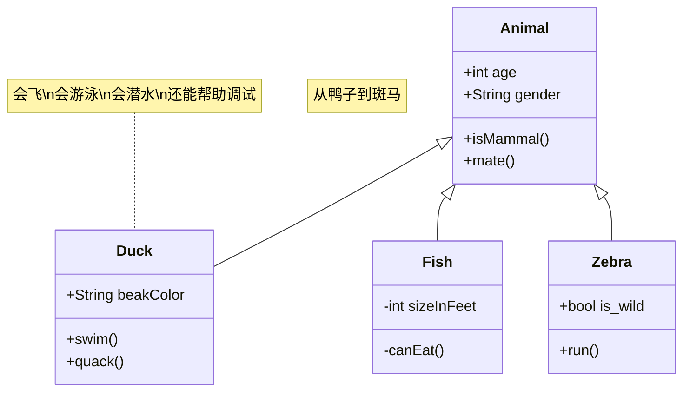

### 支持 Remixicon 图标

```text
:i{class="ri-poker-hearts-fill"}
:i{class="ri-poker-clubs-fill"}
```

:i{class="ri-poker-hearts-fill"}
:i{class="ri-poker-clubs-fill"}

### 支持按钮

```text
:btn[谷歌]{href="https://www.google.com"}
```

:btn[谷歌]{href="https://www.google.com"}

```text
:::btn{href="#"}
:i{class="ri-share-box-line"} 在新标签页中打开
:::
```

:::btn{href="#"}
:i{class="ri-share-box-line"} 在新标签页中打开
:::

### 支持 GitHub 仓库卡片

```text
::github{repo="cirry/astro-yi"}
```

::github{repo="cirry/astro-yi"}

### 支持折叠内容

```bash
:::collapse
你好，世界！
:::
```

:::collapse
你好，世界！
:::

### 支持提示块

```markdown
:::tip[自定义标题]
你好，世界
:::

:::note
这是一条说明。
:::

:::caution
请注意此处的风险。
:::

:::danger
危险操作，请谨慎处理。
:::

```

:::tip[自定义标题]
你好，世界
:::

:::note
这是一条说明。

```js
console.log('你好，世界')
```

:::

:::caution
请注意此处的风险。
:::

:::danger
危险操作，请谨慎处理。
:::

### 支持 Mermaid 图表

使用方法：

- 以此标记开始： **```mermaid**
- 以此标记结束： **```**
- 在文章顶部的配置中设置 `mermaid: true`。

Mermaid 示例代码：

```html title="mermaid.md"
classDiagram
note "从鸭子到斑马"
Animal <|-- Duck
note for Duck "会飞\n会游泳\n会潜水\n还能帮助调试"
Animal <|-- Fish
Animal <|-- Zebra
Animal : +int age
Animal : +String gender
Animal: +isMammal()
Animal: +mate()
class Duck{
+String beakColor
+swim()
+quack()
}
class Fish{
-int sizeInFeet
-canEat()
}
class Zebra{
+bool is_wild
+run()
}
```

显示效果：



### 支持 MathJax 公式

- 在文章顶部的配置中设置 `mathjax: true`。

#### 独立公式

```yaml title="Mathjax.md"
---
mathjax: true
---
你好！
$$ \sum_{i=0}^N\int_{a}^{b}g(t,i)\text{d}t $$
你好！
```

你好！
$$ \sum_{i=0}^N\int_{a}^{b}g(t,i)\text{d}t $$
你好！

#### 行内公式

```yaml title="Mathjax.md"
---
mathjax: true
---
你好！ $ \sum_{i=0}^N\int_{a}^{b}g(t,i)\text{d}t $ 你好！
```

你好！ $ \sum_{i=0}^N\int_{a}^{b}g(t,i)\text{d}t $ 你好！

### 集成 Expressive Code 代码展示

更多用法请参阅 [Expressive Code 官方文档](https://expressive-code.com/)。

```js title="line-markers.js" del={2} ins={3-4} {6}
function demo() {
  console.log('这一行被标记为删除')
  // 这一行和下一行被标记为新增
  console.log('这是第二行新增内容')

  return '这一行使用默认的中性标记'
}
```

### 默认支持代码折叠

```js
var myArr = [1, 2]
console.log(myArr)

var myObj = {a: 1, b: 2}

for (let key of myArr) {
  console.log(key)
}

var it = myArr[Symbol.iterator]()
it.next() // {value: 1, done: false}

// VM704:12 Uncaught TypeError: myObj is not iterable
for (let key of myObj) {
  console.log(key)
}

```
